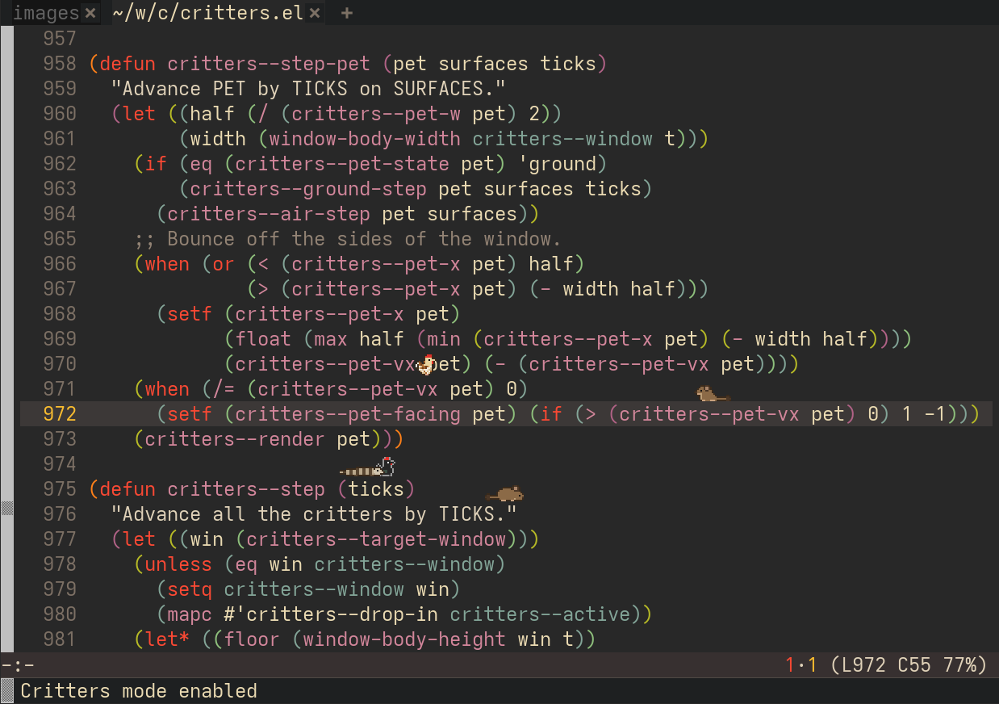

#+title: critters.el

Little pixel art critters that live in your Emacs window.  They treat
the top edges of your text as platforms: they walk along them, turn
around at their ends, and jump their way up to other lines.

It's a proof of concept for the canvas image API added in Emacs 32.

The critters:

- *Chickens* walk, jump up to five lines, and flap.  The first one is
  black, after Logan.
- *Roosters* do the same, and crow now and then.
- *Degus* scurry, do small hops, and sit up on their hind legs.
- *Blue tongue skinks* plod along slowly, flick their tongues and bask.
  They never jump, only drop off ledges.
- *Black widows* scurry fast, make small jumps, and rear up.  After
  a while they spin a web in an empty spot under some text and sit in
  it.  Webs need the shape module (see below), and stay until the
  text moves.
- *Madagascar hissing cockroaches* trundle along and raise
  themselves up to hiss.  They never jump.
- *Red wiggler worms* inch along very slowly and curl up.  They
  never jump.
- *Pill bugs* (/Armadillidium vulgare/) trundle along and roll up
  into a ball.  They never jump.
- *Totoro* lumbers along, jumps up to five lines, roars, and holds a
  leaf over his head, which he also floats down with.
- *Umbreon*, Terastallized with a crown of gems, trots along, jumps
  up to four lines, sits, makes her rings glow, and curls up to sleep.
- *Cats* walk, jump up to four lines, sit, groom, stretch, and loaf
  when they sleep.  The first one is Booboo, a calico.

* Requirements

- Emacs 32 with canvas image support (=(image-type-available-p 'canvas)=)
- A graphical frame with 32-bit color (see below)
- Optional, X11 only: =libxcb=, =xcb-shape= and =pkg-config= to build
  the shape module (see below)

On X11, Emacs has to be started with a 32-bit TrueColor visual:

#+begin_src sh
emacs -xrm 'Emacs.visualClass: TrueColor-32'
#+end_src

To make it permanent, put =Emacs.visualClass: TrueColor-32= in
=~/.Xresources= and load it with =xrdb -merge ~/.Xresources=.

* Setup

#+begin_src emacs-lisp
(add-to-list 'load-path "~/path/to/critters.el")
(require 'critters)
(critters-mode 1)
#+end_src

=M-x critters-mode= toggles them.

The critters only move while Emacs is idle.  They start after
=critters-idle-delay= seconds and freeze as soon as you run a command.
They also pause while the Emacs frame is unfocused (unless
=critters-pause-when-unfocused= is nil, handy for screen recordings)
or minimized, and after =critters-roost-delay= seconds of idle time
they settle down and close their eyes until you're back.

** Bottom style

For something less intrusive, the critters can stay on the bottom of
the window, just above the mode line, where they walk back and forth
and do their poses but never jump:

#+begin_src emacs-lisp
(setq critters-style 'bottom)
#+end_src

** Shape module (recommended on X11)

Each critter is drawn in a small child frame.  On its own, that frame
is a rectangle, so a box of your background color shows around the
critter when it's in front of text.  The optional dynamic module uses
the X Shape extension to cut each frame down to the critter's outline:

#+begin_src sh
make
#+end_src

This builds =critters-shape.so= next to =critters.el=, where it's loaded
automatically.  If it's missing, everything still works, just with the
box.  Restart Emacs after rebuilding it, since a loaded module can't be
reloaded.

** Byte compiling

Loading =critters.el= with =load-file= runs it interpreted.  For better
performance, byte-compile it and load it by name (=require= or
=(load "critters")=).  Emacs with native compilation will then also
native-compile it in the background.  Consider
=(setq load-prefer-newer t)= while editing, so an old =.elc= doesn't
shadow your changes.

* Customization

| Variable                            | Default | Description                                             |
|-------------------------------------+---------+---------------------------------------------------------|
| =critters-flock=                    |         | Which critters and how many; takes effect when toggling |
| =critters-style=                    |  frames | =frames= or =bottom=; takes effect when toggling        |
| =critters-shuffle=                  |     nil | Only some of the flock out at a time, taking turns      |
| =critters-shuffle-count=            |       2 | How many are out at once when shuffling                 |
| =critters-shuffle-interval=         |      30 | Seconds of animation between turns (nil: never)         |
| =critters-shuffle-randomize=        |     nil | Take turns in a random order                            |
| =critters-shuffle-on-buffer-switch= |     nil | Also take a turn when the window switches buffers       |
| =critters-breeds=                   |         | Palettes of each species, assigned in order             |
| =critters-scale=                    |       2 | Screen pixels per sprite pixel                          |
| =critters-fps=                      |      30 | Animation frames per second                             |
| =critters-idle-delay=               |    0.01 | Idle seconds before the critters start moving           |
| =critters-roost-delay=              |     300 | Idle seconds before they go to sleep (nil: never)       |
| =critters-pause-when-unfocused=     |       t | Pause while Emacs isn't focused (always when minimized) |
| =critters-web-delay=                |      60 | Seconds of animation before a spider spins a web        |

=critters-flock= is an alist of =(SPECIES . COUNT)=.  The default is
one of each kind, with two degus:

#+begin_src emacs-lisp
(setq critters-flock '((chicken . 1) (rooster . 1) (degu . 2) (skink . 1)
                       (spider . 1) (cockroach . 1) (worm . 1) (isopod . 1)
                       (totoro . 1) (umbreon . 1) (cat . 1)))
#+end_src

=critters-breeds= maps each species to a list of =(NAME . OVERRIDES)=.
The overrides map sprite characters to ARGB colors, plus =outline= for
the outline; the palettes in =critters--species= say what each
character is.  Chickens come in black, white, brown and buff.  For
example, to give the black chicken a green outline instead of gray:

#+begin_src emacs-lisp
(setf (alist-get 'black (alist-get 'chicken critters-breeds))
      '((?W . #xFF262626) (?G . #xFF3D4F44) (?K . #xFFE6E6E6)
        (?B . #xFF262626) (?Y . #xFF5A5A5A) (outline . #xFF3D7F4F)))
#+end_src

To have fewer critters to compute but still some variety, turn on
=critters-shuffle=: only =critters-shuffle-count= of the flock are out
at once, and every =critters-shuffle-interval= seconds of animation the
one that has been out the longest makes way for the next in the flock.
With =critters-shuffle-randomize=, a random part of the flock comes out
first, and a random one of those waiting comes out at each turn.  With
=critters-shuffle-on-buffer-switch=, a turn is also taken whenever the
window the critters are in switches to another buffer.

#+begin_src emacs-lisp
(setq critters-shuffle t
      critters-shuffle-randomize t
      critters-shuffle-on-buffer-switch t)
#+end_src

New species are entries in =critters--species=: a set of sprite frames
plus a few numbers for how they move (speed, jump reach, whether they
fly) and which actions and poses they pick from.

* How it works

- *Drawing:* each critter is a =:type canvas= image in a hidden
  buffer, shown in an undecorated child frame.  When the sprite
  changes, the canvas's ARGB =:data= vector is redrawn and
  =canvas-refresh= is called.  Moving a critter is just
  =set-frame-position=.
- *Surfaces:* the visible text is scanned for runs of non-blank
  characters, keeping the parts with nothing directly above them.
  Line positions come from the glyph matrix (=window-line-height=),
  and the result is cached until the window scrolls, resizes or the
  buffer changes.  The bottom of the window is a floor that catches
  falling critters.
- *Behavior:* on the ground a critter picks a weighted random action
  for its species: idle, walk, jump to a platform within reach, or
  hold a pose.  Jumps follow a ballistic arc, and the critter steers
  mid-air to land where it aimed.  Flying critters go from the floor
  straight back up to the nearest text.  Critters start out on random
  bits of text, and when the text under one moves away (scrolling,
  editing, a popup window closing) it snaps down onto whatever is below.

* Limitations

- The shape module is X11 only.  Without it there's a box around each
  critter.
- Text is assumed to be monospaced from the start of each line.
  Variable-pitch text, and wrapped lines with a =wrap-prefix= or
  =org-indent=, get slightly misplaced platforms.
- The top line or two of a window can't be used as platforms (there's
  no room for a critter above them), and neither can the last visible
  line.
- The critters ignore each other and can overlap.
